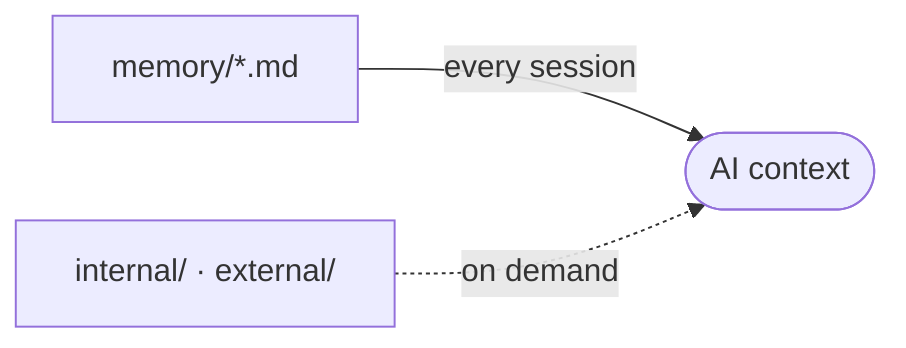

# memory/ - Project Memory

Structured context the AI assistant reads at the start of a session, so it does not rediscover the project each time.

## How it loads

The root files load every session through the project memory block in each AI context file. `internal/` and `external/` load only when relevant.

## Files

Refreshed automatically by the memory hook. Do not edit by hand.

<!-- files:start -->
- [architecture.md](architecture.md)
- [backlog.md](backlog.md)
- [codebase-map.md](codebase-map.md)
- [coding-assertions.md](coding-assertions.md)
- [database.md](database.md)
- [design.md](design.md)
- [desktop.md](desktop.md)
- [ecosystem.md](ecosystem.md)
- [forms.md](forms.md)
- [navigation.md](navigation.md)
- [project-brief.md](project-brief.md)
- [testing.md](testing.md)
- [vcs.md](vcs.md)

Read on demand:

- [internal/decisions/architecture-mv-feature-core.md](internal/decisions/architecture-mv-feature-core.md)
- [external/plugins-et-workflow/01-aidd-framework.md](external/plugins-et-workflow/01-aidd-framework.md)
- [external/plugins-et-workflow/02-workflow-macos.md](external/plugins-et-workflow/02-workflow-macos.md)
- [external/plugins-et-workflow/03-stack-et-architecture.md](external/plugins-et-workflow/03-stack-et-architecture.md)
- [external/plugins-et-workflow/04-plugin-apple-xcode.md](external/plugins-et-workflow/04-plugin-apple-xcode.md)
- [external/plugins-et-workflow/05-architectures.md](external/plugins-et-workflow/05-architectures.md)
- [external/plugins-et-workflow/06-arborescence-et-nommage.md](external/plugins-et-workflow/06-arborescence-et-nommage.md)
- [external/plugins-et-workflow/07-catalogue-skills-aidd.md](external/plugins-et-workflow/07-catalogue-skills-aidd.md)
<!-- files:end -->

## Maintaining it

The AI writes and refreshes these files. When you edit one by hand:

- One file per concern (architecture, database, vcs, ...).
- Capture the macro and the non-derivable. Point to the code, never copy it.
- Current state only, kept small. No personal notes, no future TODOs.

## Subdirectories

- `internal/`: AIDD workflow traces (the capability profile, audit notes, learn captures).
- `external/`: external references the project pulls in (specs, design docs).
