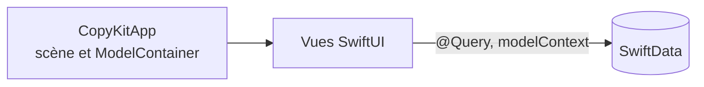

# Architecture

The macro technical shape: the stack, how the pieces fit, and the decisions behind them. Point to the code, do not restate it.

## Stack

- Swift en mode de langage Swift 6, isolation `MainActor` par défaut, concurrence « approachable ».
- SwiftUI pour toute l'interface, AppKit seulement pour ce que SwiftUI ne couvre pas.
- Projet Xcode (pas de Swift package à la racine) : Xcode gère la signature, les entitlements, les String Catalogs et l'icône.

## How it fits together

## Key decisions

- 100 % Apple : aucune dépendance tierce ; toute exception se demande d'abord.
- Architecture MV à la manière d'Apple, rangée par feature, avec un cœur isolé dans des packages Swift locaux (`CopyKitCore`, `CopyKitData`, `CopyKitSystem`) dont les dépendances vont vers le cœur : voir `aidd_docs/memory/internal/decisions/architecture-mv-feature-core.md`.
- Un objet `@Observable` suffixé `…ViewModel` seulement pour un écran qui porte de la logique propre, jamais par réflexe.
- Le rôle d'un type se lit à son suffixe, un type par fichier : voir `aidd_docs/memory/external/plugins-et-workflow/06-arborescence-et-nommage.md`.
- Les skills Apple `xcode-integration:*` font foi sur SwiftUI, Swift Testing, App Intents, l'accessibilité et la traduction.

## Gotchas

- Les packages locaux et les dossiers `Features/`, `Shared/`, `Intents/` n'existent pas encore : ils arrivent avec leur premier fichier, jamais vides.
- `project.pbxproj` se modifie par les outils MCP Xcode ; seule exception, référencer un dossier ou un fichier racine.
- Avec Xcode ouvert, ne pas basculer git sur une ref qui n'a pas le projet : Xcode signale le workspace disparu.
