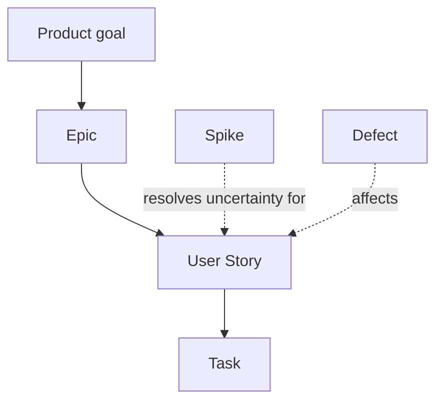

# Backlog

## Supports

| Support | Authority for | Role |
| --- | --- | --- |
| `aidd_docs/backlog/` | le contenu des artefacts : epics, stories, spikes, defects, tasks, avec leurs critères d'acceptation | la source détaillée, écrite par les skills `aidd-pm` |
| GitHub Issues | le statut et la discussion de chaque artefact | le suivi visible, relié aux PR par « Closes #n » |

## Structure

## Relations

- Cross-support: le fichier local cite son issue (`#n`) et l'issue renvoie vers le fichier
