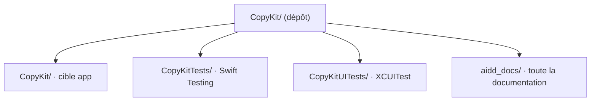

# Codebase Map

The macro layout: the top-level areas and what each holds. A map to navigate, not the full tree.

## Areas

- `CopyKit/`: la cible app ; `App/` (point d'entrée), `Resources/` (assets) ; `ContentView.swift` et `Item.swift` sont l'exemple du template Xcode, remplacés par la première story.
- `CopyKitTests/`: tests unitaires et d'intégration Swift Testing.
- `CopyKitUITests/`: tests d'interface XCUITest.
- `aidd_docs/`: toute la documentation : mémoire, décisions (`memory/internal/decisions/`), guide des plugins et du workflow (`memory/external/plugins-et-workflow/`), brief, backlog, plans.

## Entry points

- `CopyKit/App/CopyKitApp.swift` : `@main`, scène principale et conteneur SwiftData.
