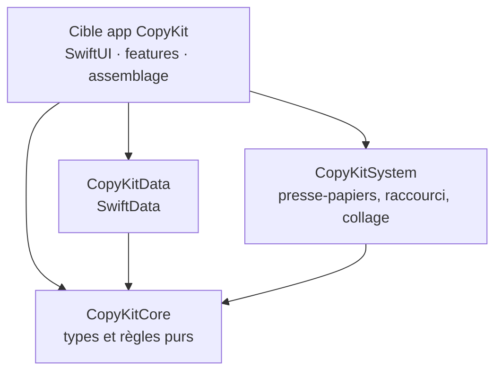

# Quelle architecture pour une app SwiftUI ? Comparatif et recommandation

← [Retour à l'index](README.md) · [Stack et architecture](03-stack-et-architecture.md)

Rédigé le 2026-10-31. Sources : la documentation Apple, les skills officiels
Apple installés (`xcode-integration:swiftui-specialist`, fiche *Data Flow*) et
les bonnes pratiques reconnues de la communauté.

---

## 1. Ce qu'Apple dit, et ce qu'Apple ne dit pas

**Apple n'impose aucune architecture.** Il n'existe pas de page « l'architecture
officielle d'Apple ». En revanche, la documentation et les skills d'Apple
décrivent clairement **comment les données doivent circuler** dans SwiftUI :

| Outil SwiftUI | Rôle selon Apple |
| --- | --- |
| `@State` | état **local** à une vue (une sélection, un champ en cours de saisie) |
| `@Observable` (macro) | **objets modèles** partagés par un sous-arbre de vues ; SwiftUI ne redessine que les vues qui lisent la propriété modifiée |
| `@Environment` / `@Entry` | partager un modèle ou un service avec toute une partie de l'app, créé au niveau de l'`App` ou d'une `Scene` |
| `Binding` | laisser une vue enfant modifier un état qui appartient à son parent |
| `@Query` (SwiftData) | lire les données stockées **directement dans une vue** |

D'après la page Apple *Managing model data in your app*, on rend les données
visibles à SwiftUI en appliquant la macro `@Observable` au modèle, et on crée
l'état partagé au niveau de l'`App` ou d'une `Scene` avant de le distribuer
par l'environnement. L'ancien couple `ObservableObject` / `@Published` ne sert
plus qu'aux apps qui visent des systèmes plus anciens (avant macOS 14).

Ce que ça implique : SwiftUI est pensé pour que **la vue soit déjà une
description de l'état**. Une couche « ViewModel » systématique n'est donc pas
nécessaire ; on ajoute un objet `@Observable` quand il y a vraiment de l'état
ou de la logique à porter.

---

## 2. Trois questions différentes, souvent mélangées

| Question | Exemples de réponses |
| --- | --- |
| **A. Comment la vue parle à l'état et à la logique ?** (le *pattern*) | MVC, MVVM, MV, Redux / TCA, VIPER |
| **B. Comment on range les fichiers ?** (l'*organisation*) | par couche, ou **par feature** |
| **C. Comment on découpe le code en modules ?** (la *modularisation*) | une seule cible, ou des **packages Swift** séparés (Clean Architecture, hexagonale) |

« L'architecture par feature » répond à la question B, « MVVM » à la question
A. On peut très bien combiner les deux.

---

## 3. Les patterns de présentation (question A)

| Pattern | Idée | Points forts | Points faibles | Avec SwiftUI en 2026 |
| --- | --- | --- | --- | --- |
| **MVC** (Model-View-Controller) | un contrôleur fait le lien entre modèle et vue | l'historique d'Apple (AppKit, UIKit) | contrôleurs énormes (« Massive View Controller ») | ❌ SwiftUI n'a pas de contrôleur |
| **MVVM** (Model-View-ViewModel) | chaque écran a un ViewModel qui prépare les données et porte la logique ; la vue ne fait qu'afficher | logique testable sans l'UI, très connu | un ViewModel par écran par réflexe, souvent du simple relais ; frotte avec SwiftData car `@Query` ne marche que dans une vue | ⚪ utile **quand un écran a vraiment de la logique**, pas systématique |
| **MV** (Model-View, le style d'Apple) | les vues lisent directement des modèles `@Observable`, l'environnement et `@Query` ; la logique vit dans les modèles et les services | le moins de code, suit la documentation Apple, idéal avec SwiftData | sans discipline, la logique peut glisser dans les vues | ✅ la base recommandée |
| **Redux / unidirectionnel, TCA** (The Composable Architecture) | un état unique, des actions, un *reducer* ; tout passe par un flux à sens unique | très prévisible et testable | beaucoup de cérémonie ; **TCA est une bibliothèque tierce** (Point-Free) | ❌ exclu par la règle « zéro dépendance tierce » |
| **VIPER** (View, Interactor, Presenter, Entity, Router) | découpage très fin de chaque écran en 5 rôles | séparation stricte | énormément de fichiers, pensé pour UIKit | ❌ trop lourd pour une app perso en SwiftUI |
| **Coordinator** | un objet gère la navigation entre écrans | utile en UIKit | SwiftUI gère la navigation par l'état (`NavigationSplitView`, sélection) | ❌ pas nécessaire |

---

## 4. Ranger le code (question B) : par couche ou par feature ?

**Par couche** (à éviter) : tous les modèles ensemble, toutes les vues
ensemble.

```text
CopyKit/
  Models/      ClipItem.swift, Settings.swift, …
  Views/       HistoryView.swift, SettingsView.swift, …
  ViewModels/  HistoryViewModel.swift, …
```

Pour modifier une seule fonctionnalité, on touche trois dossiers.

**Par feature** (recommandé) : un dossier par fonctionnalité, qui contient
tout ce qui la concerne.

```text
CopyKit/
  App/            CopyKitApp.swift (point d'entrée, assemblage)
  Features/
    History/      HistoryView.swift, HistoryRow.swift, HistoryModel.swift
    Search/       SearchField.swift, SearchModel.swift
    Settings/     SettingsView.swift, …
  Shared/         composants et tokens de design réutilisés
```

Une fonctionnalité = un dossier : on la trouve, on la modifie et on la
supprime au même endroit. C'est aussi la consigne des skills de Paul Hudson
(« folder layout determined by app features »). Les noms ci-dessus sont des
exemples : les vraies features sortiront du brief et du backlog.

---

## 5. Découper en modules (question C) : Clean Architecture « légère »

Idée de la **Clean Architecture** (ou architecture **hexagonale**, « ports et
adaptateurs ») : le cœur métier ne dépend de rien ; ce qui touche au système
(stockage, presse-papiers, raccourci clavier) se branche dessus par des
protocoles. Avec Xcode, on le fait proprement avec des **packages Swift
locaux** :



- Les flèches vont **toujours vers le cœur** : `CopyKitCore` ne connaît ni
  SwiftUI, ni SwiftData, ni AppKit, donc il se teste en quelques millisecondes.
- Chaque accès au système passe par un **protocole** avec deux
  implémentations : la vraie et une de test.
- On **commence petit** (la cible app + `CopyKitCore`) et on découpe quand un
  vrai besoin apparaît. Détails dans [03 §5](03-stack-et-architecture.md#5-principes-darchitecture).

La version « complète » de la Clean Architecture (use cases, entités,
présentateurs, repositories pour tout) est trop lourde pour une app de cette
taille : on n'en garde que la règle de dépendance et les protocoles.

---

## 6. Recommandation pour CopyKit

**MV à la manière d'Apple + organisation par feature + cœur isolé dans des
packages.**

| Élément | Règle |
| --- | --- |
| Vues | petites structs SwiftUI ; `@State` pour l'état purement visuel ; une vue par section (consigne Apple) |
| Données stockées | modèles SwiftData lus avec `@Query` **dans les vues** |
| Logique d'un écran | un objet `@Observable` par feature (par exemple `HistoryModel`) **seulement s'il y a de la logique ou de l'état à porter** ; c'est le « ViewModel » de MVVM, mais pas par réflexe |
| Services système | derrière des protocoles dans `CopyKitSystem`, injectés par l'environnement (`@Entry`) depuis l'`App` |
| Règles métier | fonctions et types purs dans `CopyKitCore`, testés avec Swift Testing |
| Rangement | un dossier par feature |
| Navigation | par l'état (`NavigationSplitView`, sélection), sans Coordinator |

Pièges à éviter :

- un ViewModel par écran « parce que MVVM » qui ne fait que relayer des
  propriétés ;
- un modèle géant qui contient tout l'état de l'app : en découper un plus petit
  quand beaucoup de vues partagent peu de données (consigne Apple) ;
- `ObservableObject` et `@Published` : remplacés par `@Observable` ;
- mettre des closures ou des valeurs instables dans l'environnement (fiche
  *Environment* du skill Apple) ;
- utiliser `@Query` hors d'une vue : ça ne fonctionne pas.

✅ Choix validé le 2026-10-31 : [ADR 0001](../../internal/decisions/architecture-mv-feature-core.md).

## Sources

- [Managing model data in your app (Apple)](https://developer.apple.com/documentation/swiftui/managing-model-data-in-your-app.md)
- [Monitoring model data changes in your app (Apple, ancienne approche)](https://developer.apple.com/documentation/swiftui/monitoring-model-data-changes-in-your-app.md)
- Skill Apple `xcode-integration:swiftui-specialist`, fiches *Data Flow*, *View Structure* et *Environment Performance*
