# AI-Driven Dev Framework (AIDD)

← [Retour à l'index](README.md)

## En une phrase

AIDD installe un cycle de développement complet (SDLC) dans Claude Code :
une idée devient un contrat, un plan, du code validé, une revue
indépendante puis une pull request en draft. Il est **agnostique de la
stack** : il ne sait rien de Swift ni de macOS. Il apporte la méthode
(cadrage, plan, revue, commits, PR), pas les recettes techniques Mac.

## Comment l'appeler

- Chaque skill s'appelle `/<plugin>:<NN-nom>`, par exemple
  `/aidd-dev:01-plan`. Tu peux aussi le demander en langage naturel (« fais
  un plan pour… ») : Claude choisit le skill d'après sa description.
- La plupart des skills sont des **routers** : le `SKILL.md` décrit une suite
  d'actions, et chaque action vit dans un fichier `actions/NN-*.md` que Claude
  lit au moment de l'exécuter.
- Les arguments (`argument-hint`) indiquent ce que le skill attend, par
  exemple `setup | refresh | rewire` pour la mémoire projet.

## Conventions communes

| Convention | Détail |
| --- | --- |
| Dossier de travail | `aidd_docs/` à la racine : `memory/` (mémoire projet), `tasks/<yyyy_mm>/…` (plans, audits), `INSTALL.md`, `recipes/` |
| Statuts d'un plan | `pending → in-progress → implemented` (ou `blocked`) ; phases `pending → in-progress → done` |
| Validation humaine | Les skills PM et VCS ne créent rien (ticket, PR, release) sans ton accord explicite |
| Commits | Conventionnels, un sujet par commit ; convention du projet dans `aidd_docs/memory/vcs.md` si elle existe |
| Push | Jamais de `--force` ; push seulement si demandé |
| Langue des questions | Questions « naturelles », sans exposer la mécanique interne |

## Vue d'ensemble

```mermaid
flowchart LR
  subgraph setup["Une fois"]
    onboard["aidd-context:00-onboard"] --> memory["aidd-context:02-project-memory"]
  end
  subgraph frame["Cadrer"]
    brainstorm["aidd-refine:01-brainstorm"] --> spec["aidd-pm:04-spec"]
  end
  subgraph deliver["Livrer"]
    plan["aidd-dev:01-plan"] --> implement["aidd-dev:02-implement"] --> assert["aidd-dev:03-assert"]
  end
  subgraph check["Vérifier"]
    review["aidd-dev:05-review"] --> challenge["aidd-refine:02-challenge"]
  end
  subgraph ship["Livrer"]
    commit["aidd-vcs:01-commit"] --> pr["aidd-vcs:02-pull-request"] --> learn["aidd-context:10-learn"]
  end
  memory --> brainstorm
  spec --> plan
  assert --> review
  challenge --> commit
```



`aidd-orchestrator:01-sdlc` enchaîne tout ce flux tout seul.

---

## 🧭 aidd-context : le contexte et la mémoire du projet

Produit la connaissance que l'IA a du projet : mémoire, artefacts de contexte
(skills, rules, agents, commandes, hooks), diagrammes, apprentissages.

**Hook embarqué** : au `SessionStart`, `hooks/update_memory.js` (Node)
synchronise le bloc mémoire dans `CLAUDE.md`, `AGENTS.md` et
`.github/copilot-instructions.md`. Il ne remplit qu'un bloc déjà présent,
délimité par `<!-- aidd_project_memory:start -->` et `<!-- aidd_project_memory:end -->`.
Les fichiers à la racine de `aidd_docs/memory/` sont importés en `@` (toujours
chargés) ; `internal/` et `external/` sont listés « à lire à la demande ».

| Skill | À quoi il sert | Quand l'utiliser | Ce qu'il produit | Pour une app macOS |
| --- | --- | --- | --- | --- |
| `00-onboard` | Guide pas à pas : lit le projet, dit où tu en es dans le flux AIDD et propose l'étape suivante (boucle scan → assess → present → run) | Première fois, ou « je fais quoi maintenant ? » | Un menu numéroté ; n'exécute rien sans ta réponse | ✅ point d'entrée AIDD |
| `01-bootstrap` | Architecte technique d'un **SaaS** : checklist de 24 points, 2-3 stacks candidates auditées par des agents en parallèle | Nouveau projet dont la stack n'est pas choisie | `aidd_docs/INSTALL.md` uniquement, aucun code | ❌ inutile ici : la stack (Swift/SwiftUI, projet Xcode) est déjà fixée |
| `02-project-memory` | Construit la mémoire du projet (architecture, conventions, décisions) et la branche dans les outils IA | `setup` après le scaffold, `refresh` quand le code a dérivé, `rewire` pour rebrancher un outil | `aidd_docs/memory/*`, bloc mémoire dans `CLAUDE.md` | ✅ après la création de l'app |
| `03-context-generate` | Router : envoie vers le bon générateur quand le type d'artefact n'est pas nommé | « crée-moi un artefact pour… » | Rien lui-même | ⚪ |
| `04-skill-generate` | Crée ou modifie un skill (router + actions), `create` ou `modify` | Transformer un workflow répété en skill | Un dossier skill par outil IA confirmé | ⚪ ex. un skill qui pilote la CLI de l'app |
| `05-rule-generate` | Crée, met à jour ou supprime une règle de code (convention) | Ancrer une convention Swift du projet | Fichiers de règle par outil | ⚪ |
| `06-agent-generate` | Crée un agent ou sous-agent spécialisé | Besoin d'un rôle dédié | Un fichier agent par outil | ⚪ |
| `07-command-generate` | Crée une commande slash simple (one-shot) | Raccourci pour une action répétée | Un fichier commande | ⚪ |
| `08-hook-generate` | Crée un hook (script lancé à un événement : PreToolUse, Stop…) | Automatiser au cycle de vie (ex. `grid-lint` après chaque édition Swift) | Entrée dans les settings + script | ⚪ |
| `09-mermaid` | Diagramme Mermaid valide à partir d'un texte : plan → confirmation → génération → revue | Documenter une architecture ou un flux | Un bloc ```mermaid | ⚪ |
| `10-learn` | Capture un apprentissage durable (décision, piège, convention), le note, puis le range dans la mémoire, un ADR, une règle ou un nouveau skill | Après un bug instructif ou une décision | Fichiers du projet seulement, jamais la mémoire globale | ✅ en fin de feature |
| `11-explore` | Cartographie le projet sur 3 axes : outillage installé, contexte (mémoire, specs), code | « qu'est-ce qui est installé ? », « quel skill pour X ? » | Une carte ; pointe vers un item, ne le lance jamais | ⚪ |
| `12-cook` | Gère des recettes (guides pratiques) : lister, rechercher, créer, appliquer, valider | Documenter une technique réutilisable | `aidd_docs/recipes/*` | ⚪ |

Légende : ✅ utile dans le parcours macOS · ⚪ ponctuel ou optionnel · ❌ pas adapté.

---

## ⚙️ aidd-dev : transformer le code

| Skill | À quoi il sert | Comment il marche | Pour une app macOS |
| --- | --- | --- | --- |
| `01-plan` | Transforme une demande, un ticket ou un fichier en **plan par phases**. N'écrit jamais de code | `capture` → `explore` (lit le code, pose les questions bloquantes) → `conclude` (phases, wireframe ASCII par écran, validation par script, relecture par un sous-agent) | ✅ pour chaque story |
| `02-implement` | Exécute un plan existant phase par phase jusqu'à ce que tous les critères d'acceptation passent | `prepare` (plan + branche) → `execute` (tâche par tâche) → `finalize`. **Un commit local par tâche validée**, statut du plan mis à jour | ✅ |
| `03-assert` | Vérifie que le travail fonctionne : relance les assertions du projet et corrige jusqu'au vert | Facettes : `assert` (toujours), `assert-architecture` (sur demande, rapporte seulement), `assert-frontend` (UI qui tourne, pensée pour le web) | ✅ facette code ; pour l'UI Mac : XCUITest et les Previews |
| `04-audit` | Audit **en lecture seule** sur 7 piliers : qualité, architecture, sécurité, dépendances, performance, tests, UI | Demande « les 7 ou un seul ? » ; écrit `aidd_docs/tasks/<yyyy_mm>/<date>_audit/<pilier>.md` + `report.md` | ✅ en fin de milestone |
| `05-review` | Revue d'un diff avant de livrer : qualité du code, comportement vs plan, pertinence | Statique (ne lance jamais l'app) ; verdict `approve`, `changes-requested` ou `blocked` | ✅ avant chaque PR |
| `06-test` | Écrit et fait passer des tests côté dev, ou valide un parcours dans le **navigateur** | `test` (trouver ce qui n'est pas testé) ou `test-journey` (navigateur) | ⚠️ `test` oui ; `test-journey` non (web). Pour le Mac : Swift Testing et XCUITest |
| `07-refactor` | Améliore le code sur 4 axes : performance, sécurité, nettoyage, architecture | Comportement préservé (sauf sécurité) ; peut prendre un rapport d'audit comme liste de corrections | ✅ |
| `08-debug` | Corrige un bug connu, trouve une cause inconnue, ou relance une enquête bloquée | `reproduce` (test qui échoue → fix → PR), `debug` (hypothèses), `reflect-issue` (logs d'abord) | ✅ |
| `09-for-sure` | Boucle autonome qui réessaie jusqu'à ce qu'une commande de succès passe | Pré-vol interactif, puis boucle sans toi. ⚠️ « auto-accept » : agit à ta place (crée des comptes, génère des clés) sauf paiement ou action destructive | ⚠️ à utiliser avec prudence |
| `10-batch` | Découpe une demande en tâches indépendantes, les exécute en parallèle, résume chaque agent | Une demande en plusieurs parties sans dépendances | ⚪ |

### Les deux agents

| Agent | Rôle | Garde-fous |
| --- | --- | --- |
| `executor` | Transforme une tâche cadrée en code validé qui suit les conventions du projet. Décide du **comment**, jamais du **quoi** | N'écrit jamais de plan ni de critère, ne juge pas son propre travail, ne délègue pas, s'arrête si une action humaine est requise (paiement, 2FA). Skills : implement, assert, test, debug, commit |
| `checker` | Juge un travail fini dans un contexte vierge, contre ses critères **et** le vrai besoin. Exige des preuves (sorties de commandes, fichiers) | N'édite jamais, ne corrige jamais. Checklist : pas de duplication, pas d'incohérence, pas de sur-ingénierie, pas de code mort. Skills : review, audit, challenge |

C'est la séparation exécutant / vérificateur qui donne sa valeur à `01-sdlc`.

---

## 🌿 aidd-vcs : Git et la forge

| Skill | À quoi il sert | Points clés |
| --- | --- | --- |
| `00-repo-init` | `git init`, branche par défaut, commit d'amorçage, `CONTRIBUTING.md`, remote en option (`publish`) | Expérimental. Idempotent : ne fait rien si le dépôt existe déjà (c'est le cas de CopyKit) |
| `01-commit` | Commits conventionnels atomiques, un sujet par commit | Options `auto` (ne demande rien), `interactive`, `push`. Réessaie après un hook refusé seulement pour des corrections déterministes dans les mêmes fichiers |
| `02-pull-request` | Ouvre une PR (GitHub) ou une MR (GitLab) **en draft** | Base déduite du préfixe de branche, jamais supposée `main`. Ne commit, ne push et ne crée jamais de branche |
| `03-release-tag` | Release semver avec tag annoté et notes de version | Te fait valider version, notes et fichiers avant de taguer |
| `04-issue-create` | Crée une issue dans l'outil de ticketing configuré | Attend ton accord sur titre, corps, labels |
| `05-resolve-conflict` | Résout les conflits Git déterministes, propose les autres | S'arrête après le staging : ne commit pas, ne continue pas le rebase |

Ces skills collent à ta règle « jamais sur `main` » : travail sur une branche
`claude/*`, puis `01-commit` et `02-pull-request`.

---

## 📋 aidd-pm : le produit et le backlog

Règles communes : les décisions produit restent à toi, preuves / décisions /
hypothèses séparées, aucune écriture sans accord explicite.

| Skill | À quoi il sert | Quand l'utiliser | Pour une app macOS |
| --- | --- | --- | --- |
| `01-ticket-info` | Affiche un ticket depuis l'outil de ticketing | « montre-moi l'issue #12 » | ⚪ si tu utilises les issues GitHub |
| `02-user-stories` | Découpe et ordonne des User Stories (slices verticales, acceptance, readiness) sans inventer d'estimation | Depuis un Epic, un Brief ou un PRD | ✅ le backlog de l'app (`docs/STORIES.md`) |
| `03-prd` | Product Requirements Document (le quoi et le pourquoi, jamais le comment) | Besoin d'un PRD formel | ⚪ souvent trop lourd pour une app perso |
| `04-spec` | Spec = **contrat immuable** d'une feature : intention, peu de critères, aucune solution. N'explore pas le code | Avant de planifier une grosse feature | ✅ pour les features complexes |
| `05-spike` | Spike borné pour lever une incertitude (faisabilité, estimation, design) | « est-ce faisable de… ? » | ✅ ex. détecter les mots de passe copiés |
| `06-product-brief` | Product Brief : l'opportunité et comment la valider | Cadrer un produit | ✅ le cadrage de l'app |
| `07-epic` | Epic orienté résultat | Regrouper plusieurs stories | ⚪ |
| `08-three-amigos` | Évalue un Epic ou une Story sous 3 angles (produit, delivery, qualité), puis réconcilie 3 rapports | Raffiner avant de toucher au backlog | ⚪ |
| `09-defect` | Enregistre un défaut observé (écart produit), sans le diagnostiquer | Un bug constaté à tracer | ⚪ |
| `10-task` | Tâche technique bornée sans valeur utilisateur directe | Travail d'infra, de config | ⚪ |

---

## 🪞 aidd-refine : réfléchir avant et après

| Skill | À quoi il sert | Ce qu'il produit | Pour une app macOS |
| --- | --- | --- | --- |
| `01-brainstorm` | Clarifie une idée floue par des questions qui changent ce qui sera construit. Ne planifie et ne code jamais | L'idée affinée, approuvée | ✅ en tout début si l'idée est vague |
| `02-challenge` | Remet en cause un travail fini face au plan convenu : deal-breaker, suggestion ou correct, avec un score de confiance | Rapport rempli depuis `assets/report-template.md` | ✅ après une implémentation |
| `03-shadow-areas` | Cherche les angles morts d'un document (idée, stories, PRD, spec) : 7 catégories, 3 niveaux de gravité, une question par trou | Rapport, `status: clean` quand il ne reste ni bloquant ni majeur. Relançable en mode `diff` | ✅ sur `docs/BRIEF.md` et `docs/STORIES.md` |
| `04-fact-check` | Vérifie les affirmations factuelles d'un texte (mémoire projet → code → web en dernier) et réécrit avec des notes de bas de page | Texte corrigé + `## Sources` + `## Unverified claims` | ⚪ ex. vérifier une recherche sur la concurrence |
| `05-improve` | Analyse une conversation terminée pour réduire le temps et les tokens perdus | Recommandations et éditions de fichiers proposées | ⚪ |

---

## 🎼 aidd-orchestrator : enchaîner automatiquement

### `01-sdlc` : une demande → une PR en draft

```text
/aidd-orchestrator:01-sdlc "ajouter la recherche dans l'historique"
/aidd-orchestrator:01-sdlc interactive "ajouter la recherche dans l'historique"
```

Trois zones, chacune délègue à d'autres skills :

1. **Frame** : si la source cite un ticket → `aidd-pm:01-ticket-info`. Si
   l'intention est floue → `aidd-refine:01-brainstorm`. S'il manque le
   contrat → `aidd-pm:04-spec`. Si c'est déjà prêt → direct.
2. **Deliver** : `aidd-dev:01-plan`, puis l'agent `executor` lance
   `02-implement` → `03-assert` → (`06-test` si un parcours E2E est prévu) →
   `aidd-vcs:01-commit` (commit **et push**).
3. **Check** : un agent `checker` neuf lance `aidd-dev:05-review`, puis
   `aidd-refine:02-challenge`. Les remarques produit repartent en Frame, les
   corrections indépendantes passent par `10-batch`, les autres repassent en
   Deliver. Quand tout est propre → `aidd-vcs:02-pull-request` (draft).

Modes :

- `auto` (par défaut) : va jusqu'à la PR sans rien demander, sauf avant une
  dépense, une action irréversible ou une décision qui t'appartient.
- `interactive` (premier mot de la demande) : 3 pauses, sur le contrat, sur
  le plan, sur le résultat avant la PR. Un refus repart vers la zone
  concernée.

### `00-async-dev` : issues GitHub → PR, en tâche de fond

Router à 3 sous-flux :

- `setup` (11 actions) : génère `.github/workflows/aidd-async.yml` et
  `.claude/aidd-orchestrator.json`, crée les labels `to-implement`,
  `to-review` et `claude/*`, configure les secrets ou un poll local.
- `run` : prend une issue labellisée `to-implement`, pose le verrou
  `claude/working` et délègue à `01-sdlc`.
- `review` : traite les commentaires d'une PR labellisée `to-review`.

Demande un remote GitHub. ⚪ À voir bien plus tard, quand l'app aura un
backlog d'issues.

### `02-backlog` : piloter le backlog

`ask | create | manage | review | refine` : tri des nouvelles demandes,
raffinement (via `three-amigos`), revue de santé, réparation. Délègue
l'écriture aux skills `aidd-pm`. ⚪ Utile si tu gères le backlog en issues
plutôt que dans `docs/STORIES.md`.

---

## Ce qu'AIDD n'apporte pas pour le Mac

- Aucune connaissance Swift, SwiftUI, AppKit, ni des APIs macOS.
- Les tests de parcours (`06-test` journey, `aidd-qa`) et la facette
  `assert-frontend` visent le **navigateur**.
- `01-bootstrap` vise un SaaS.

Ces trous sont couverts par le plugin officiel Apple ([04-plugin-apple-xcode.md](04-plugin-apple-xcode.md)), la documentation Apple (Human Interface Guidelines) et les principes de [03-stack-et-architecture.md](03-stack-et-architecture.md).
