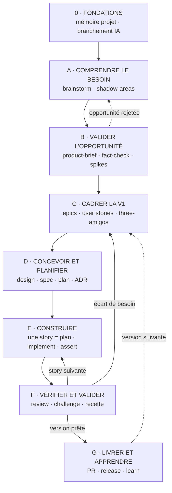

# Workflow : construire CopyKit avec Apple + AIDD

← [Retour à l'index](README.md) · Détails : [AIDD](01-aidd-framework.md) · [Stack et architecture](03-stack-et-architecture.md) · [Plugin Apple](04-plugin-apple-xcode.md)

## Le principe : qui fait quoi

- **Apple outille et fait foi** : Xcode 27.1, `xcodebuild`, Swift Testing,
  XCUITest, Previews, Instruments, Icon Composer, `swift-format`. Son plugin
  officiel `xcode-integration` apporte les skills SwiftUI, Swift Testing, App
  Intents, accessibilité et traduction, et le serveur MCP `xcode` donne à
  Claude un accès direct à Xcode ([04](04-plugin-apple-xcode.md)).
- **AIDD pilote et contrôle** : clarifier, cadrer, découper, planifier,
  implémenter tâche par tâche, revue indépendante, challenge, audit, commits,
  PR, capitalisation.
- **Les règles de conception** sont écrites dans
  [03-stack-et-architecture.md](03-stack-et-architecture.md) et suivent les
  Human Interface Guidelines d'Apple.

Aucun outil tiers, aucun script maison qui remplace un outil Apple.

### Quel skill pour quel besoin

| Besoin | Skill / outil |
| --- | --- |
| Clarifier une idée | `aidd-refine:01-brainstorm` |
| Cadrer le produit | `aidd-pm:06-product-brief` |
| Lever une incertitude technique | `aidd-pm:05-spike` |
| Écrire le backlog | `aidd-pm:07-epic` puis `aidd-pm:02-user-stories` |
| Spec d'une grosse feature | `aidd-pm:04-spec` |
| Trouver les trous d'un document | `aidd-refine:03-shadow-areas` |
| Planifier | `aidd-dev:01-plan` |
| Implémenter | `aidd-dev:02-implement`, avec les skills Apple `swiftui-specialist`, `swiftui-whats-new-27` |
| Modèles et persistance | documentation Apple SwiftData (option non installée : `swiftdata-pro` de Paul Hudson) |
| Code async, actors, erreurs de concurrence | documentation Swift (option non installée : `swift-concurrency-pro` de Paul Hudson) |
| Faire passer les tests | `aidd-dev:03-assert` (lance `xcodebuild test`) |
| Écrire des tests | `aidd-dev:06-test` (action `test`) + skill Apple `modernize-tests` |
| Voir l'interface | Previews + captures XCUITest, relues avec les Human Interface Guidelines |
| Accessibilité | skills Apple `accessibility-voiceover-specialist`, `accessibility-sufficient-contrast-specialist` |
| Actions Raccourcis / Spotlight | skills Apple `app-intents-specialist`, `app-intents-whats-new-27` |
| Traduction | skill Apple `translation-coordinator` |
| Bug | `aidd-dev:08-debug` + test Swift Testing qui échoue |
| Revue avant PR | `aidd-dev:05-review` puis `aidd-refine:02-challenge` |
| Audit | `aidd-dev:04-audit` + skill Apple `audit-xcode-security-settings` |
| Refactor | `aidd-dev:07-refactor` |
| Performance | Instruments / `xctrace` + `aidd-dev:07-refactor` (axe performance) |
| Commits, PR, release | `aidd-vcs:01-commit`, `02-pull-request`, `03-release-tag` |
| Leçons et décisions | `aidd-context:10-learn` (mémoire, ADR, règle) |

---

## Le cadre déjà en place

Fait le 2026-10-31 et fusionné sur `main` (PR #1) :

1. **Ta propre application**, conçue de zéro.
2. **Projet Xcode**, Xcode 27.1, Swift 6.4, SDK macOS 27, mode de langage Swift 6.
3. **100 % natif** : zéro dépendance tierce ; plugin officiel Apple installé.
4. **Architecture** : MV par feature avec un cœur isolé, [ADR 0001](../adr/0001-architecture-mv-feature-core.md).
5. **App Sandbox** : reste à décider à l'étape B.

---

## Les étapes du projet : de l'idée floue au produit

Les six étapes A à F ont été proposées par Yanis et confrontées au flux officiel
d'AIDD (skill `aidd-context:00-onboard`, fichier `references/flow.md`). Elles sont
gardées, avec trois corrections :

| Correction | Pourquoi |
| --- | --- |
| **Ajout d'une étape 0 · Fondations** avant A | Pour un projet qui a déjà du code, AIDD exige d'abord la **mémoire projet** puis de la **brancher aux outils IA**. Sinon, chaque skill repart de zéro à chaque session |
| **F n'est pas une étape finale, c'est une boucle** | Dans AIDD, on vérifie **chaque story** avant sa PR (`assert` → `review` → `challenge`). Attendre la fin pour vérifier accumule les défauts. F a donc deux niveaux : par story (dans E) et par version (recette) |
| **Ajout d'une étape G · Livrer et apprendre** | Sans elle, le cycle ne se referme pas : publier une version, capitaliser (`learn`), puis repartir sur la version suivante |

Une remarque sur l'ordre : l'architecture (ADR 0001) a été décidée **avant**
l'étape A. Ce n'est pas un problème, car elle ne dépend d'aucune fonctionnalité.
En revanche, elle sera **remise en question à l'étape D** face au brief et au
backlog (`aidd-refine:02-challenge`).

### 0 · Fondations (une fois, maintenant)

| # | Commande | Sortie | Statut |
| --- | --- | --- | --- |
| 0.1 | Stack technique | Xcode 27.1, Swift 6, ADR 0001 | ✅ fait |
| 0.2 | Plugin officiel Apple | `xcode-integration@apple-xcode` | ✅ fait |
| 0.3 | `/aidd-context:00-onboard` | **Point d'entrée officiel d'AIDD** : il lit le projet, le classe (ici « existant » : du code, pas de mémoire), puis propose l'étape suivante dans un menu. Il n'exécute rien sans ta réponse | ⏳ à faire |
| 0.4 | `/aidd-context:02-project-memory setup`, proposé par l'onboarding | `aidd_docs/memory/` : architecture, conventions, décisions | ⏳ à faire |
| 0.5 | Brancher la mémoire (étape `sync` du même skill) | bloc mémoire dans `CLAUDE.md`, tenu à jour par le hook `SessionStart` | ⏳ à faire |

À tout moment par la suite, relancer `/aidd-context:00-onboard` pour savoir où
on en est : il suit le flux d'une feature (brainstorm, spec, plan, implement,
assert, review, commit, PR) et indique l'étape suivante.

**Critère de sortie** : `aidd_docs/memory/` existe, et `CLAUDE.md` contient le
bloc `aidd_project_memory`.

### A · Comprendre le besoin

| # | Commande | Rôle |
| --- | --- | --- |
| A.1 | `/aidd-refine:01-brainstorm` | Transformer l'idée floue en idée précise : quel problème, pour qui, dans quelle situation, ce qui est hors sujet. Ne planifie et ne code rien |
| A.2 | `/aidd-refine:03-shadow-areas` sur l'idée affinée | Lister les angles morts, avec une question par trou |

**Critère de sortie** : une idée affinée, approuvée, sans angle mort bloquant.

### B · Valider l'opportunité

| # | Commande | Rôle |
| --- | --- | --- |
| B.1 | `/aidd-pm:06-product-brief` | Un Product Brief : problème, cible, alternatives existantes, preuves, hypothèses, **comment on saura que ça marche**. Ses étapes internes : cadrer → découvrir (recherche, challenge) → visualiser → rédiger → valider |
| B.2 | `/aidd-refine:04-fact-check` sur le brief | Vérifier les affirmations (concurrents, prix, capacités de macOS), avec sources |
| B.3 | `/aidd-pm:05-spike "<question>"` | Lever chaque **risque de faisabilité** qui peut tuer l'idée. Exemple : coller dans une autre app exige Accessibility, qui est incompatible avec l'App Sandbox |
| B.4 | Décision **go / no-go** + décision **sandbox** | Tracées dans un ADR |

**Critère de sortie** : un Product Brief approuvé, les risques bloquants levés,
une décision go. Pour une app personnelle, cette étape peut être courte, mais
elle ne se saute pas : c'est elle qui évite de construire ce qui existe déjà
gratuitement, ou ce que macOS ne permet pas.

### C · Cadrer la première version

| # | Commande | Rôle |
| --- | --- | --- |
| C.1 | `/aidd-pm:07-epic` | Un Epic par grand résultat attendu de la V1 |
| C.2 | `/aidd-pm:02-user-stories` | Des stories découpées en tranches verticales, ordonnées. Chaque critère d'acceptation dit s'il se prouve par Swift Testing, XCUITest ou un essai manuel |
| C.3 | `/aidd-pm:08-three-amigos` | Regard produit, delivery et qualité sur chaque Epic et chaque story importante |
| C.4 | `/aidd-refine:03-shadow-areas` sur les stories | Trous dans les critères |
| C.5 | `/aidd-orchestrator:02-backlog` *(optionnel)* | Tenir le backlog cohérent (ordre, dépendances, santé) |

**Critère de sortie** : un backlog V1 ordonné, avec une liste explicite de ce
qui n'est **pas** dans la V1.

### D · Concevoir et planifier

| # | Commande | Rôle |
| --- | --- | --- |
| D.1 | `/aidd-refine:02-challenge` sur l'ADR 0001 | Vérifier que l'architecture tient face au brief et au backlog |
| D.2 | Conception de l'app (`docs/DESIGN.md`) | Forme de l'app (fenêtre, menu bar, panneau), pages, carte des commandes et raccourcis, états vides, d'après les Human Interface Guidelines |
| D.3 | Design system : tokens Swift + `docs/DESIGN-SYSTEM.md` ; icône dans Icon Composer | Couleurs, espacements, rayons, animations |
| D.4 | `/aidd-pm:04-spec` *(pour les stories complexes)* | Contrat immuable de la feature, sans solution technique |
| D.5 | `/aidd-dev:01-plan S-0XX` | Plan par phases de la prochaine story, avec un wireframe ASCII si elle a une UI |
| D.6 | `/aidd-context:10-learn` | Chaque décision difficile à défaire → un ADR |

**Critère de sortie** : la conception validée et un plan prêt pour la première
story. Le plan se fait **story par story**, juste avant de la construire, pas
tout d'un coup.

### E · Construire le produit (boucle par story)

| # | Commande | Rôle |
| --- | --- | --- |
| E.1 | `/aidd-dev:02-implement` | Code + tests, un commit local par tâche validée, avec les skills Apple (`swiftui-specialist`, `swiftui-whats-new-27`, `modernize-tests`) |
| E.2 | `/aidd-dev:03-assert` | `xcodebuild test` jusqu'au vert |
| E.3 | `/aidd-dev:06-test` (action `test`) | Combler les comportements non testés |
| E.4 | `/aidd-dev:08-debug` *(si besoin)* | Bug : reproduire, test qui échoue, correction |

Variante tout-en-un pour une story lourde ou risquée :
`/aidd-orchestrator:01-sdlc interactive "<story>"`. Elle enchaîne D.5, E et F.1
à F.3, avec trois pauses : sur le contrat, sur le plan et sur le résultat.

### F · Vérifier et valider (deux niveaux)

**Par story, avant chaque PR :**

| # | Commande | Rôle |
| --- | --- | --- |
| F.1 | `/aidd-dev:05-review` | Revue du diff : qualité, conformité à la story, pertinence |
| F.2 | `/aidd-refine:02-challenge` | Le résultat sert-il vraiment le besoin ? |
| F.3 | Previews + captures XCUITest, clair et sombre | Conformité aux critères et aux Human Interface Guidelines |

**Par version, avant de livrer :**

| # | Commande | Rôle |
| --- | --- | --- |
| F.4 | Recette manuelle | Tu utilises l'app réelle et tu coches les critères `[manual]` |
| F.5 | `/aidd-dev:04-audit` | Audit en lecture seule sur 7 piliers |
| F.6 | Skills Apple d'accessibilité + Accessibility Inspector | VoiceOver, contrastes |
| F.7 | Skill Apple `audit-xcode-security-settings` | Réglages de sécurité du build |
| F.8 | Instruments / `xctrace` | Réactivité et mémoire |
| F.9 | `/aidd-dev:07-refactor` | Corriger ce que l'audit a trouvé |

`aidd-qa` n'est pas utilisable ici : il ne teste que dans un navigateur.

### G · Livrer et apprendre

| # | Commande | Rôle |
| --- | --- | --- |
| G.1 | `/aidd-vcs:01-commit` puis `/aidd-vcs:02-pull-request` | Une PR draft par story, que tu promeus et que tu merges |
| G.2 | `/aidd-vcs:03-release-tag` | Version semver, tag annoté, notes de version |
| G.3 | Archive Xcode → Developer ID → `notarytool` → `stapler` | Distribuer une app signée et notarisée (ou Mac App Store si le sandbox reste) |
| G.4 | `/aidd-context:10-learn` | Capitaliser : mémoire, ADR, règles |
| G.5 | Retours d'usage → `/aidd-pm:09-defect` ou nouvelles stories | Ils alimentent la version suivante (retour en C) |

---

## Points d'attention

1. **Branches** : `02-implement` commite à chaque tâche et `01-sdlc` pousse.
   Toujours lancer depuis une branche `claude/*` (le hook `protect-main.sh`
   bloque `main`).
2. **`CLAUDE.md`** : il contient déjà les vraies commandes (`xcodebuild`) ;
   `project-memory` (étape 0) y ajoute son bloc entre marqueurs, tenu à jour
   par le hook `SessionStart`.
3. **Serveur MCP Xcode** : il lui faut Xcode ouvert sur le projet (ou le mode
   sans fenêtre). Réexporter les skills Apple après chaque mise à jour d'Xcode.
4. **`aidd-dev:09-for-sure`** agit à ta place (crée des comptes, génère des
   clés) sauf paiement ou destruction. À réserver aux tâches bien bornées.
5. **Navigateur ≠ Mac** : `aidd-dev:06-test` (journey), la facette frontend
   d'`03-assert` et `aidd-qa` testent des pages web. Pour l'app : XCUITest.
6. **Données réelles** : tests sur un `ModelContainer` en mémoire, jamais sur
   les vraies données.
7. **Permissions** : la signature automatique avec ton équipe garde les
   autorisations macOS (Accessibility…) d'un build à l'autre.

---

## Aide-mémoire : « je veux… »

| Je veux… | Commande / outil |
| --- | --- |
| Savoir où j'en suis | `/aidd-context:00-onboard` |
| Créer la mémoire projet | `/aidd-context:02-project-memory setup` |
| Valider l'opportunité | `/aidd-pm:06-product-brief` puis `/aidd-pm:05-spike` |
| Clarifier une idée | `/aidd-refine:01-brainstorm` |
| Écrire le backlog | `/aidd-pm:02-user-stories` |
| Trouver les trous d'un document | `/aidd-refine:03-shadow-areas <fichier>` |
| Construire une story | `/aidd-dev:01-plan S-0XX` puis `/aidd-dev:02-implement` |
| Livrer une grosse feature de bout en bout | `/aidd-orchestrator:01-sdlc interactive "<feature>"` |
| Lancer les tests | `/aidd-dev:03-assert` (ou `xcodebuild test`) |
| Ajouter des tests | `/aidd-dev:06-test` |
| Corriger un bug | `/aidd-dev:08-debug` |
| Mesurer la performance | Instruments / `xctrace` |
| Faire relire avant PR | `/aidd-dev:05-review` puis `/aidd-refine:02-challenge` |
| Commiter | `/aidd-vcs:01-commit` |
| Ouvrir une PR | `/aidd-vcs:02-pull-request` |
| Auditer le code | `/aidd-dev:04-audit` |
| Retenir une leçon | `/aidd-context:10-learn` |
| Sortir une version | `/aidd-vcs:03-release-tag` |
