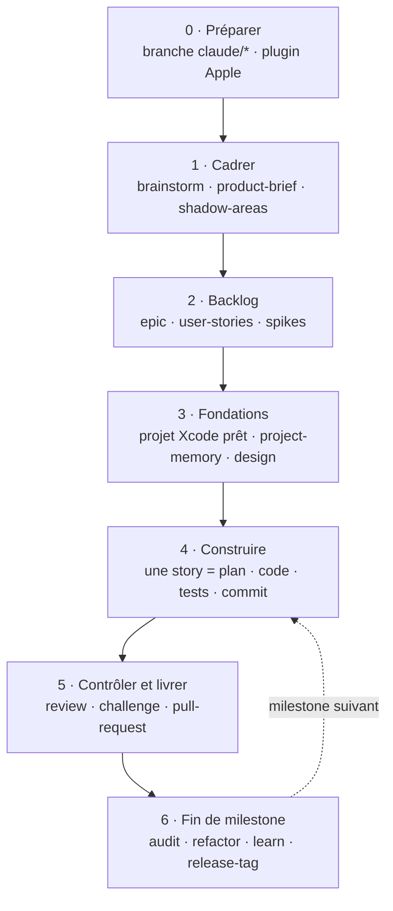

# Workflow : construire CopyKit avec Apple + AIDD

← [Retour à l'index](README.md) · Détails : [AIDD](01-aidd-framework.md) · [Stack et architecture](03-stack-et-architecture.md) · [Plugin Apple](04-plugin-apple-xcode.md)

## Le principe : qui fait quoi

- **Apple outille et fait foi** : Xcode 27.1, `xcodebuild`, Swift Testing,
  XCUITest, Previews, Instruments, Icon Composer, `swift-format`. Son plugin
  officiel `xcode-integration` apporte les skills SwiftUI, Swift Testing, App
  Intents, accessibilité et traduction, et le serveur MCP `xcode` donne à
  Claude un accès direct à Xcode ([04](04-plugin-apple-xcode.md)).
- **AIDD pilote et contrôle** : clarifier, cadrer, découper, planifier,
  implémenter tâche par tâche, revue indépendante, challenge, audit, commits,
  PR, capitalisation.
- **Les règles de conception** sont écrites dans
  [03-stack-et-architecture.md](03-stack-et-architecture.md) et suivent les
  Human Interface Guidelines d'Apple.

Aucun outil tiers, aucun script maison qui remplace un outil Apple.

### Quel skill pour quel besoin

| Besoin | Skill / outil |
| --- | --- |
| Clarifier une idée | `aidd-refine:01-brainstorm` |
| Cadrer le produit | `aidd-pm:06-product-brief` |
| Lever une incertitude technique | `aidd-pm:05-spike` |
| Écrire le backlog | `aidd-pm:07-epic` puis `aidd-pm:02-user-stories` |
| Spec d'une grosse feature | `aidd-pm:04-spec` |
| Trouver les trous d'un document | `aidd-refine:03-shadow-areas` |
| Planifier | `aidd-dev:01-plan` |
| Implémenter | `aidd-dev:02-implement`, avec les skills Apple `swiftui-specialist`, `swiftui-whats-new-27` |
| Modèles et persistance | `swiftdata-pro` (Paul Hudson) |
| Code async, actors, erreurs de concurrence | `swift-concurrency-pro` (Paul Hudson) |
| Faire passer les tests | `aidd-dev:03-assert` (lance `xcodebuild test`) |
| Écrire des tests | `aidd-dev:06-test` (action `test`) + skill Apple `modernize-tests` + `swift-testing-pro` (Paul Hudson) |
| Voir l'interface | Previews + captures XCUITest, relues avec les Human Interface Guidelines |
| Accessibilité | skills Apple `accessibility-voiceover-specialist`, `accessibility-sufficient-contrast-specialist` |
| Actions Raccourcis / Spotlight | skills Apple `app-intents-specialist`, `app-intents-whats-new-27` |
| Traduction | skill Apple `translation-coordinator` |
| Bug | `aidd-dev:08-debug` + test Swift Testing qui échoue |
| Revue avant PR | `aidd-dev:05-review` puis `aidd-refine:02-challenge` |
| Audit | `aidd-dev:04-audit` + skill Apple `audit-xcode-security-settings` |
| Refactor | `aidd-dev:07-refactor` |
| Performance | Instruments / `xctrace` + `aidd-dev:07-refactor` (axe performance) |
| Commits, PR, release | `aidd-vcs:01-commit`, `02-pull-request`, `03-release-tag` |
| Leçons et décisions | `aidd-context:10-learn` (mémoire, ADR, règle) |

---

## Le cadre retenu pour CopyKit

Détails dans [03-stack-et-architecture.md](03-stack-et-architecture.md) :

1. **Ta propre application**, conçue de zéro.
2. **Projet Xcode existant**, Xcode 27.1, Swift 6.4, SDK macOS 27.
3. **100 % natif** : zéro dépendance tierce.
4. **Swift 6** : passer `SWIFT_VERSION` de 5.0 au mode de langage 6.
5. **App Sandbox** : décidé au brief. Décision tracée dans un ADR.
6. **Architecture** : cible app fine + packages Swift locaux, dépendances
   dirigées vers le cœur, coutures testables. À confirmer par ADR.

---

## L'ordre d'utilisation, étape par étape

### Phase 0 : préparer (une fois)

| # | Commande | Rôle |
| --- | --- | --- |
| 0.1 | `git checkout -b claude/<sujet>` | Ta règle : jamais de travail sur `main` |
| 0.2 | ✅ fait : plugin officiel Apple `xcode-integration@apple-xcode` installé | Skills Apple + serveur MCP Xcode ([04](04-plugin-apple-xcode.md)) |
| 0.2b | `/plugin install` de `swiftdata-pro`, `swift-concurrency-pro`, `swift-testing-pro` | Plugins de Paul Hudson pour SwiftData, la concurrence et Swift Testing ([04 §3](04-plugin-apple-xcode.md#3-les-alternatives-communautaires)) |
| 0.3 | `/aidd-context:00-onboard` *(optionnel)* | Voir où en est le projet côté AIDD |

### Phase 1 : cadrer l'app

| # | Commande | Quand | Sortie |
| --- | --- | --- | --- |
| 1.1 | `/aidd-refine:01-brainstorm` | Tant que l'idée n'est pas nette | Idée affinée |
| 1.2 | `/aidd-pm:06-product-brief` | Toujours : à qui sert l'app, ce qu'elle remplace, comment valider. Y trancher la question du sandbox | Product Brief |
| 1.3 | `/aidd-refine:03-shadow-areas <brief>` | Avant de découper | Rapport des angles morts |
| 1.4 | `/aidd-refine:04-fact-check` | Si le brief cite des faits (concurrents, APIs) | Faits vérifiés et sourcés |

### Phase 2 : le backlog

| # | Commande | Rôle |
| --- | --- | --- |
| 2.1 | `/aidd-pm:07-epic` | Un Epic par grand résultat attendu |
| 2.2 | `/aidd-pm:02-user-stories` | Stories ordonnées, critères d'acceptation vérifiables : préciser pour chaque critère s'il est prouvé par Swift Testing, XCUITest ou un essai manuel |
| 2.3 | `/aidd-pm:08-three-amigos` *(optionnel)* | Regard produit / delivery / qualité sur un Epic ou une Story |
| 2.4 | `/aidd-refine:03-shadow-areas <stories>` | Trous dans les critères |
| 2.5 | `/aidd-pm:05-spike "<question>"` | Chaque incertitude technique bloquante (permissions, APIs système) |

### Phase 3 : les fondations

| # | Commande | Rôle |
| --- | --- | --- |
| 3.1 | `/aidd-dev:01-plan "préparer le projet Xcode"` puis `/aidd-dev:02-implement` | Mode Swift 6, premier package Swift local (`CopyKitCore`), Test Plan (unitaires + UI, clair et sombre, couverture), réglage `swift-format`, `CLAUDE.md` avec les commandes `xcodebuild build` / `xcodebuild test`. Un ADR par décision structurante |
| 3.2 | `/aidd-context:02-project-memory setup` | Mémoire projet `aidd_docs/memory/` + bloc dans `CLAUDE.md` |
| 3.3 | Design plan (dans le brief ou `docs/DESIGN.md`) | Forme de l'app (fenêtre, menu bar, panneau), pages, carte des commandes et raccourcis, états vides, d'après les Human Interface Guidelines |
| 3.4 | Tokens de design en Swift + `design/DESIGN-SYSTEM.md` | Accent, rayons, espacements, animations ([03 §6](03-stack-et-architecture.md#6-principes-de-design)) |
| 3.5 | Icône dans Icon Composer | Xcode compile le fichier `.icon` |
| 3.6 | `/aidd-vcs:01-commit` puis `/aidd-vcs:02-pull-request` | Commit propre + PR draft des fondations |

### Phase 4 : construire, story par story

| # | Commande | Rôle |
| --- | --- | --- |
| 4.1 | `/aidd-dev:01-plan S-0XX` | Plan par phases, wireframe ASCII si la story a une UI |
| 4.2 | `/aidd-dev:02-implement` | Code + tests, un commit local par tâche validée, en suivant les skills Apple, `swiftdata-pro`, `swift-concurrency-pro`, `swift-testing-pro` et `design/DESIGN-SYSTEM.md` |
| 4.3 | `/aidd-dev:03-assert` | `xcodebuild test` jusqu'au vert |
| 4.4 | Regarder Previews et captures XCUITest (clair et sombre) | Comparer aux critères de la story et aux Human Interface Guidelines |
| 4.5 | Mettre la story à jour (statut `done`) | Dans le même commit que le code |

Variante tout-en-un pour une feature lourde ou risquée :
`/aidd-orchestrator:01-sdlc interactive "<story ou feature>"` (contrat → plan
→ exécution par `executor` → revue par `checker` → PR draft).

### Phase 5 : contrôler et livrer

| # | Commande | Rôle |
| --- | --- | --- |
| 5.1 | `/aidd-dev:05-review` | Revue statique du diff |
| 5.2 | `/aidd-refine:02-challenge` | Le résultat sert-il vraiment le besoin ? |
| 5.3 | `/aidd-vcs:01-commit` | Si des corrections ont suivi |
| 5.4 | `/aidd-vcs:02-pull-request` | PR en draft vers `main` ; tu la promeus et tu merges |

(Avec `01-sdlc`, les étapes 5.1 à 5.4 sont incluses.)

### Phase 6 : fin de milestone

| # | Commande | Rôle |
| --- | --- | --- |
| 6.1 | `/aidd-dev:04-audit` | Audit 7 piliers en lecture seule (dont architecture, tests, UI) |
| 6.2 | skill Apple `audit-xcode-security-settings` | Durcir les réglages de sécurité du build |
| 6.3 | `/aidd-dev:07-refactor` | Appliquer l'audit, axe par axe, comportement prouvé identique |
| 6.4 | Instruments + mesures XCTest | Vérifier les objectifs de réactivité |
| 6.5 | `/aidd-context:10-learn` | Ranger les leçons durables (mémoire, ADR, règle) |
| 6.6 | `/aidd-vcs:03-release-tag` | Version semver + notes, après merge sur `main` |

### Plus tard (optionnel)

| Quoi | Avec |
| --- | --- |
| Actions dans Raccourcis et Spotlight | App Intents + skills Apple `app-intents-*` |
| Traduction | skill Apple `translation-coordinator` |
| Formatage automatique après chaque édition Swift | `aidd-context:08-hook-generate` avec `swift-format` |
| Distribution | Archive Xcode → Developer ID → `notarytool` → `stapler` |
| Issues GitHub → PR automatiques | `aidd-orchestrator:00-async-dev` |

---

## Points d'attention

1. **Branches** : `02-implement` commite à chaque tâche et `01-sdlc` pousse.
   Toujours lancer depuis une branche `claude/*` (le hook `protect-main.sh`
   bloque `main`).
2. **`CLAUDE.md`** : créé en phase 3 avec les vraies commandes (`xcodebuild`,
   Test Plan, `swift-format`) ; `project-memory` y ajoute son bloc entre
   marqueurs, tenu à jour par le hook `SessionStart`.
3. **Serveur MCP Xcode** : il lui faut Xcode ouvert sur le projet (ou le mode
   sans fenêtre). Réexporter les skills Apple après chaque mise à jour d'Xcode.
4. **`aidd-dev:09-for-sure`** agit à ta place (crée des comptes, génère des
   clés) sauf paiement ou destruction. À réserver aux tâches bien bornées.
5. **Navigateur ≠ Mac** : `aidd-dev:06-test` (journey), la facette frontend
   d'`03-assert` et `aidd-qa` testent des pages web. Pour l'app : XCUITest.
6. **Données réelles** : tests sur un `ModelContainer` en mémoire, jamais sur
   les vraies données.
7. **Permissions** : la signature automatique avec ton équipe garde les
   autorisations macOS (Accessibility…) d'un build à l'autre.

---

## Aide-mémoire : « je veux… »

| Je veux… | Commande / outil |
| --- | --- |
| Savoir où j'en suis | `/aidd-context:00-onboard` |
| Clarifier une idée | `/aidd-refine:01-brainstorm` |
| Cadrer le produit | `/aidd-pm:06-product-brief` |
| Écrire le backlog | `/aidd-pm:02-user-stories` |
| Trouver les trous d'un document | `/aidd-refine:03-shadow-areas <fichier>` |
| Préparer le projet Xcode | `/aidd-dev:01-plan` puis `/aidd-dev:02-implement` |
| Construire une story | `/aidd-dev:01-plan S-0XX` puis `/aidd-dev:02-implement` |
| Livrer une grosse feature de bout en bout | `/aidd-orchestrator:01-sdlc interactive "<feature>"` |
| Lancer les tests | `/aidd-dev:03-assert` (ou `xcodebuild test`) |
| Ajouter des tests | `/aidd-dev:06-test` |
| Corriger un bug | `/aidd-dev:08-debug` |
| Mesurer la performance | Instruments / `xctrace` |
| Faire relire avant PR | `/aidd-dev:05-review` puis `/aidd-refine:02-challenge` |
| Commiter | `/aidd-vcs:01-commit` |
| Ouvrir une PR | `/aidd-vcs:02-pull-request` |
| Auditer le code | `/aidd-dev:04-audit` |
| Retenir une leçon | `/aidd-context:10-learn` |
| Sortir une version | `/aidd-vcs:03-release-tag` |
